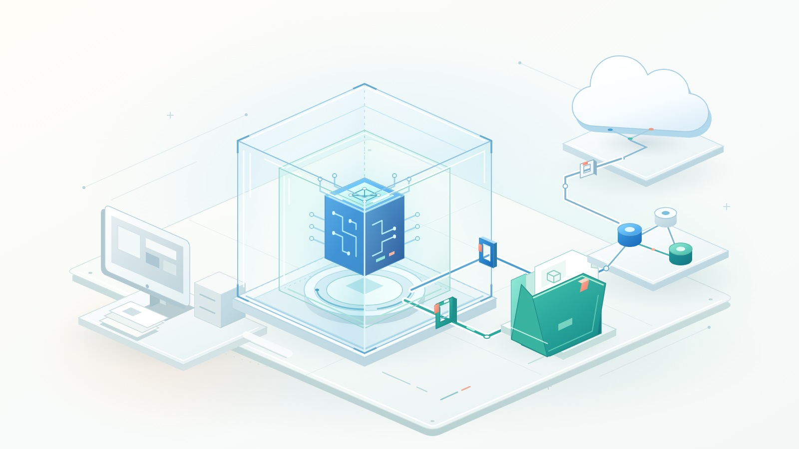

An agent fixing a failing test needs to read code, install dependencies, and run commands. It probably does not need your SSH keys, access to another client's repository, or a connection to a production database. Yet a terminal running under your account may expose all three.

The question is not whether you trust the model to be helpful. It is whether the environment limits the consequences when the model, a dependency, or an instruction it encounters is wrong.

**Sandbox the execution, not just the conversation.** GitHub Copilot and Docker both offer sandboxing, but the boundaries are different. They can also work together.

{/* truncate */}



*Documentation checked November 5, 2026. Commands and platform support change; check the linked documentation against your installed version.*

## Why isolation matters

Coding agents connect untrusted inputs to powerful tools. A repository, issue, web page, or tool response can contain instructions that attempt to redirect the agent. This is prompt injection: content supplied as task data tries to become authority. Dependency installation adds another risk because package scripts execute code independently of the model's intentions.

An ordinary mistake can have similar consequences. An agent may delete the wrong directory, alter shared configuration, or send debugging information to an inappropriate destination.

Approval prompts help, but repeatedly approving commands is not a containment strategy. Permission asks, "May the agent run this tool?" A sandbox limits what that tool can actually reach after approval. Repository instructions describe desired behavior; they are not an operating-system access control.

Separate three questions:

- **Execution:** Which processes and files can the agent access or modify?
- **Connectivity:** Which destinations and services can it reach?
- **Authority:** Which actions can its credentials authorize there?

A strong execution boundary does not fix a broadly privileged token. A network allowlist does not make every destination on that list trustworthy. And isolating the local process does not make a cloud model local: permitted prompts, code context, and tool results can still leave the machine.

## GitHub Copilot: local restrictions or a cloud session?

"Copilot sandbox" can describe two different approaches. Choose explicitly rather than assuming every Copilot surface has the same isolation.

### Local sandboxing: keep your tools, restrict their reach

[Copilot local sandboxing](https://docs.github.com/en/copilot/concepts/security-governance-and-network-settings/about-cloud-and-local-sandboxes) uses Microsoft eXecution Container, or MXC, to apply OS-level restrictions. It does **not** put the entire session inside a separate VM or conventional container.

The implementation depends on the host: Seatbelt on macOS, bubblewrap on Linux, and supported Windows 11 isolation capabilities. Linux needs additional networking components; Windows features depend on installed updates. Check prerequisites rather than assuming that a working CLI means a working sandbox.

Local sandboxing is off by default unless managed settings require it. Inside an interactive Copilot CLI session, start with:

```text
/sandbox enable
/sandbox status
/sandbox policy
```

The enabled preference persists across sessions. Copilot app settings are separate from CLI settings. Inspect the effective policy, not just the saved toggle.

The [filesystem policy](https://docs.github.com/en/copilot/concepts/security-governance-and-network-settings/understanding-local-sandboxing) includes automatic grants for the working directory, Git metadata, tools, and selected caches. Working in a repository subdirectory can still grant read access across the repository. Some tool configuration files contain registry credentials, and some writable caches are shared with unsandboxed commands. "Only this folder" is not a safe assumption without inspecting those grants.

There is another important boundary: shell commands and search subprocesses receive OS enforcement, while built-in file-reading and editing tools run inside the unsandboxed CLI and check policy in software. Local MCP and language servers are sandboxed by default; remote MCP servers are not local processes and are not contained by that boundary.

[Network and credential settings](https://docs.github.com/en/copilot/how-tos/cloud-and-local-sandboxes/configuring-local-sandbox-settings) also deserve attention. Supported authentication flows can use placeholders with a proxy injecting credentials at approved destinations. That is not automatic protection for every secret in a file or environment variable.

Network enforcement is platform-dependent. On macOS and Linux, proxied traffic is constrained against direct outbound bypass. On Windows, host-rule proxying depends on programs honoring proxy settings and requires supported OS capabilities. Do not treat those configurations as equivalent egress guarantees.

For enforced organizational use, administrators should require sandboxing, disable sandbox bypass, and configure fail-closed behavior when it is unavailable. A saved user preference alone can be disabled for the current CLI session on an unsupported host, with a notice. Read that notice before delegating work.

**Choose this for:** everyday local development where retaining the host toolchain is useful and the documented boundary meets your risk requirements.

### Cloud sandboxes: move the session off your laptop

A [Copilot cloud sandbox](https://docs.github.com/en/copilot/concepts/security-governance-and-network-settings/about-cloud-sandboxes) runs the whole session in a GitHub-hosted, isolated Linux environment. It clones the repositories needed for the task; it does not operate on your laptop's working directory.

From Copilot CLI, start an interactive cloud session with:

```bash
copilot --cloud
```

This is useful for parallel work, longer tasks, and continuing a session from another client. Local sandbox settings do not transfer to it. Cloud sessions have usage-based billing, and stopped sessions retain snapshots so work can resume. Stopped does not mean erased.

Also distinguish **Cloud** from **Actions** execution. GitHub documents Actions-based sessions separately for runner customization, setup steps, or Windows requirements. A self-hosted runner inherits the risks of the environment you provide; "remote" is not itself a security boundary.

Cloud sandboxes use Copilot's cloud-agent firewall settings. However, the [documented firewall limitations](https://docs.github.com/en/copilot/how-tos/copilot-on-github/customize-copilot/customize-the-firewall) include coverage limited to agent-started Bash processes, not direct coverage of MCP server processes or configured setup steps. GitHub also warns about bypass potential. Use it as a layer, not a proof that exfiltration is impossible.

**Choose this for:** delegated repository work that should not consume local resources or reach local files, when organizational policy permits cloud execution.

## Docker Sandboxes: a microVM around the agent

[Docker Sandboxes](https://docs.docker.com/ai/sandboxes/architecture/) provides a different local boundary: a microVM with its own kernel and Docker Engine. The agent can install packages and run containers inside that environment without receiving your host Docker daemon.

This is not equivalent to an ordinary `docker run`. Conventional Linux containers share their container host's kernel. Mounting the host Docker socket into one also grants powerful control over that daemon and can undermine the intended host boundary. Docker Sandboxes gives the workload a separate daemon instead.

The current [installation documentation](https://docs.docker.com/ai/sandboxes/install/) uses the standalone `sbx` CLI; it does not require Docker Desktop or Docker Engine on the host. Supported local platforms include Apple-silicon macOS, Windows 11 with the required hypervisor, and supported Ubuntu systems with KVM. Hardware virtualization matters, including nested virtualization when the host is itself a VM.

Docker supplies a [Copilot integration](https://docs.docker.com/ai/sandboxes/agents/copilot/), alongside other coding agents. This is not a choice between Copilot's intelligence and Docker's intelligence. Copilot is the agent; Docker supplies its execution environment.

### The workspace is still a deliberate opening

The [workspace modes](https://docs.docker.com/ai/sandboxes/usage/) have different consequences:

- **Direct mount:** `sbx run` defaults to sharing the current directory read-write. Agent edits immediately change host files, including hidden files and Git hooks.
- **Clone mode:** the host repository is mounted read-only, and the agent works in a private clone inside the VM. Read-only prevents modification, not disclosure of secrets in that source directory.
- **Mountless:** create a sandbox without a workspace path, then clone or copy only the material needed into it.

After installing `sbx`, signing in to Docker, and configuring a suitable Copilot credential through Docker's documented authentication flow, a cautious starting point is:

```bash
sbx create --clone --name agent-lab --skills=off copilot .
sbx policy ls
sbx run --name agent-lab
```

Run this from a clean, secret-free main repository checkout, not a linked Git worktree. Pause after inspecting the rules and narrow them before starting the agent. `--skills=off` avoids sharing the host-side agent skills store for this sandbox.

Docker's Copilot template currently starts the agent with `--yolo`. That makes the outer boundary especially important: do not assume normal per-tool confirmations remain in place. The example is a starting workflow, not a complete security policy.

### Credentials and integrations cross boundaries too

For [proxy-managed credentials](https://docs.docker.com/ai/sandboxes/configuration/credentials/), the agent sees a placeholder and the host proxy injects the real value into matching outbound requests. Raw secrets placed in workspace files or ordinary environment variables do not gain that protection. A hidden token can still authorize a powerful request; scope its permissions.

The [security model](https://docs.docker.com/ai/sandboxes/security/) documents deny-by-default networking with preconfigured allowed destinations. Review those rules: broad domain wildcards may cover more than the API you intended. Local stdio MCP servers registered with Docker's gateway run on the **host**, outside the microVM. Treat them as trusted integrations with their own permissions.

Sandbox state persists until removal. Stopping the agent does not discard installed packages or changes. Export reviewed work before deleting a clone-mode sandbox.

Docker also offers [cloud sandboxes](https://docs.docker.com/ai/sandboxes/cloud/local-vs-cloud/), but local mounts, credentials, policies, and lifecycle behavior do not transfer unchanged. Evaluate the cloud configuration separately.

## Which approach would I choose?

| Situation | Starting choice | Main tradeoff |
|-----------|-----------------|---------------|
| Familiar repository, existing local toolchain | Copilot local sandboxing | Low workflow disruption; host-dependent enforcement and automatic grants |
| Delegated work without laptop access or compute | Copilot cloud sandbox | Managed remote execution; separate policy, data handling, and usage costs |
| Agent needs Docker builds and test containers | Local Docker Sandbox, possibly running Copilot | Separate kernel and daemon; virtualization and resource overhead |
| Unfamiliar code or install scripts | Disposable microVM or dedicated VM, minimal shared data | Stronger separation; still requires narrow egress and credentials |
| Production changes or sensitive customer data | Separate approved workflow | None of these makes unrestricted production authority acceptable |

These are starting points, not a ranking. A microVM with broad credentials and a writable home-directory mount can expose more useful authority than a carefully constrained lighter-weight environment.

## Two practical use cases

### 1. Update a dependency in a familiar service

Suppose an agent must update a logging library, adapt a few calls, and run unit tests. The repository and build process are familiar, but the new dependency still deserves review.

I would start with Copilot local sandboxing, inspect the effective policy, exclude secrets, and allow only the package sources required. I would not give the task deployment credentials. A disposable checkout keeps unrelated work separate, although the checkout itself is not a security sandbox.

The output should be a focused diff, dependency changes, and test evidence. Review lockfile changes and installation scripts, not just application code. If the upgrade involves unfamiliar scripts or broader privileges, move execution into a disposable VM boundary rather than approving increasingly broad local exceptions.

### 2. Reproduce a bug in a container-based project

Now imagine an unfamiliar service with a Compose stack, a database, and migration scripts. The agent needs to build images and repeatedly reset test data.

Docker Sandboxes fits because the agent gets a private Docker Engine without the host socket. Use a sanitized clone or mountless workspace, synthetic database records, and no production connection strings. Restrict network destinations to the required registries and services.

The agent can recreate its test stack without authority over the developer's other containers. Before importing the result, inspect scripts, Dockerfiles, Compose configuration, and dependencies. In direct-mount mode, also check `.git/hooks` separately: hooks do not appear in an ordinary `git diff`.

If neither the laptop nor its network should participate, use an approved cloud environment with equivalent controls. That is a placement decision, not a reason to drop the controls.

## Alternatives worth considering

**Dev containers and GitHub Codespaces:** dev containers make tooling reproducible but are not automatically hardened environments for untrusted agents. Review mounts, privileges, secrets, and Docker socket access. [Codespaces](https://docs.github.com/en/codespaces/reference/security-in-github-codespaces) adds a dedicated VM and network per codespace, but outbound internet is allowed and injected secrets remain available to processes. It is useful when you want a full remote development environment, with security policy configured deliberately.

**Azure Container Apps dynamic sessions:** [dynamic sessions](https://learn.microsoft.com/en-us/azure/container-apps/sessions) provide Hyper-V-isolated execution for untrusted code. They are worth evaluating when building an application that needs agent-generated code execution, rather than choosing an interactive developer CLI. You still own authorization, data placement, network configuration, and session lifecycle.

A dedicated disposable VM is also a valid choice when a product's supported platforms or controls do not match your requirements. You then own image maintenance, hardening, and cleanup.

## Verify the boundary before increasing autonomy

Use a small acceptance checklist, not a reassuring product name:

1. **Inventory exposure.** Identify readable files, writable mounts, shared caches, credentials, MCP tools, and reachable services. Keep production secrets out.
2. **Probe safely.** Use harmless canary files inside and outside the allowed workspace and an approved test destination outside the allowlist. Check that permitted operations work and denied operations fail. Never use real secrets as test data.
3. **Check enforcement paths.** Inspect sandbox status, effective rules, platform limitations, and bypass settings. A shell probe does not establish that built-in file tools or remote MCP services have identical enforcement.
4. **Bound the run.** Set appropriate CPU, memory, time, and spending limits where supported. Preserve useful logs without collecting sensitive payloads.
5. **Review and retire.** Review the diff and relevant hidden configuration, run independent checks, export only the needed artifacts, then remove disposable environments and revoke temporary credentials.

Sandboxing reduces the blast radius of execution. It does not prevent every prompt injection, guarantee generated code is correct, or undo an authorized action against an external service.

Choose the boundary around what the task must reach, not around how much you trust the agent. Give it room to work inside that boundary, and keep the authority to change the boundary outside its control.
