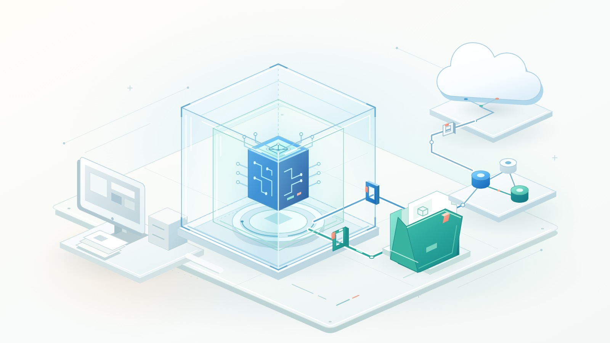

Corregir una prueba exige leer código, instalar dependencias y ejecutar comandos. No suele exigir claves SSH, repositorios de otros clientes ni bases de datos de producción. Sin embargo, una terminal con tu cuenta puede exponer las tres cosas.

No basta con confiar en la intención del modelo. El entorno debe limitar las consecuencias cuando falla el modelo, una dependencia o una instrucción que encuentre.

**Aísla la ejecución, no solo la conversación.** GitHub Copilot y Docker ofrecen sandboxes, pero sus límites son diferentes. También pueden funcionar juntos.

{/* truncate */}



*Documentación consultada el 5 de noviembre de 2026. Los comandos y las plataformas cambian; comprueba la documentación para tu versión.*

## Por qué importa el aislamiento

Los agentes conectan entradas no confiables con herramientas potentes. Repositorios, incidencias, páginas web y respuestas de herramientas pueden intentar redirigirlos. Eso es una inyección de instrucciones: contenido recibido como datos intenta convertirse en autoridad. Las dependencias añaden otro riesgo: sus scripts ejecutan código independientemente de las intenciones del modelo.

También basta un error: borrar el directorio equivocado, alterar configuración compartida o enviar información de depuración a un destino inadecuado.

Las confirmaciones ayudan, pero aprobar comandos no constituye contención. El permiso pregunta: «¿Puede el agente ejecutar esta herramienta?». El sandbox limita su alcance después de aprobarla. Las instrucciones del repositorio describen comportamientos esperados; no son controles de acceso del sistema operativo.

Separa tres preguntas:

- **Ejecución:** ¿Qué procesos puede ejecutar y qué archivos puede leer o modificar?
- **Conectividad:** ¿Qué destinos y servicios puede alcanzar?
- **Autoridad:** ¿Qué acciones autorizan allí sus credenciales?

Un aislamiento sólido no corrige tokens con privilegios excesivos. Permitir destinos tampoco los vuelve confiables. Aislar el proceso no convierte un modelo en la nube en uno local: instrucciones, contexto del código y resultados permitidos todavía pueden salir del equipo.

## GitHub Copilot: ¿restricciones locales o una sesión en la nube?

«Sandbox de Copilot» describe dos enfoques. Elige explícitamente: sus interfaces no ofrecen necesariamente el mismo aislamiento.

### Aislamiento local: conserva tus herramientas y limita su alcance

El [aislamiento local de Copilot](https://docs.github.com/en/copilot/concepts/security-governance-and-network-settings/about-cloud-and-local-sandboxes) utiliza Microsoft eXecution Container, o MXC, para aplicar restricciones del sistema operativo. **No** coloca toda la sesión dentro de una máquina virtual o un contenedor convencional independiente.

La implementación utiliza Seatbelt en macOS, bubblewrap en Linux y capacidades de aislamiento de Windows 11 compatible. Linux necesita componentes adicionales de red; Windows depende de las actualizaciones instaladas. Comprueba los requisitos: una CLI operativa no garantiza un sandbox operativo.

El aislamiento local está desactivado por defecto, salvo que una política administrada lo exija. Dentro de una sesión interactiva de Copilot CLI, comienza con:

```text
/sandbox enable
/sandbox status
/sandbox policy
```

La preferencia persiste entre sesiones. La configuración de la aplicación Copilot es independiente de la CLI. Inspecciona la política efectiva, no solo la opción guardada.

La [política del sistema de archivos](https://docs.github.com/en/copilot/concepts/security-governance-and-network-settings/understanding-local-sandboxing) concede permisos automáticos al directorio de trabajo, metadatos de Git, herramientas y determinadas cachés. Un subdirectorio puede seguir concediendo lectura de todo el repositorio. Algunas configuraciones contienen credenciales de registros; ciertas cachés escribibles se comparten con comandos externos. Revisa los permisos antes de suponer «solo esta carpeta».

Otro límite importante: el sistema operativo restringe comandos y subprocesos de búsqueda, pero las herramientas integradas de lectura y edición comprueban la política mediante software dentro de la CLI no aislada. Los servidores MCP y de lenguaje locales se aíslan por defecto; los MCP remotos quedan fuera de ese límite.

Revisa también la [configuración de red y credenciales](https://docs.github.com/en/copilot/how-tos/cloud-and-local-sandboxes/configuring-local-sandbox-settings). La autenticación compatible puede usar valores sustitutos mientras un proxy introduce credenciales para destinos aprobados. Eso no protege automáticamente los demás secretos de archivos o variables de entorno.

En macOS y Linux, las restricciones impiden eludir el proxy mediante conexiones directas. En Windows, las reglas de hosts dependen de que los programas respeten el proxy y de capacidades compatibles del sistema. No son garantías equivalentes de salida.

Los administradores deberían exigir aislamiento, impedir excepciones y bloquear la ejecución cuando no esté disponible. En equipos incompatibles, una preferencia personal puede desactivarse para la sesión actual de la CLI, con un aviso. Léelo antes de delegar.

**Elígelo para:** desarrollo local habitual cuando conviene conservar las herramientas del equipo y el límite documentado satisface tus requisitos de riesgo.

### Sandboxes en la nube: saca la sesión de tu portátil

Un [sandbox de Copilot en la nube](https://docs.github.com/en/copilot/concepts/security-governance-and-network-settings/about-cloud-sandboxes) ejecuta la sesión completa en Linux aislado, alojado por GitHub. Clona los repositorios necesarios; no trabaja sobre tu directorio local.

Desde Copilot CLI, inicia una sesión interactiva en la nube con:

```bash
copilot --cloud
```

Sirve para trabajo paralelo, tareas largas y sesiones retomadas desde otro cliente. La configuración local no se transfiere. Hay facturación por uso; las sesiones detenidas conservan instantáneas para retomarlas. Detener no significa borrar.

Distingue también la ejecución **Cloud** de **Actions**. GitHub documenta sesiones basadas en Actions para personalizar runners, preparar el entorno o utilizar Windows. Un runner autohospedado hereda los riesgos del entorno que proporcionas; «remoto» no constituye por sí mismo un límite de seguridad.

Estos sandboxes usan el firewall del agente en la nube. Sus [limitaciones documentadas](https://docs.github.com/en/copilot/how-tos/copilot-on-github/customize-copilot/customize-the-firewall) restringen la cobertura a procesos Bash iniciados por el agente, no directamente a servidores MCP ni pasos de preparación. GitHub advierte que puede eludirse. Es una capa, no una garantía contra filtraciones.

**Elígelo para:** trabajo delegado sobre repositorios que no deba consumir recursos ni alcanzar archivos locales, cuando la política organizativa permita ejecutarlo en la nube.

## Docker Sandboxes: una microVM alrededor del agente

[Docker Sandboxes](https://docs.docker.com/ai/sandboxes/architecture/) ofrece otro límite local: una microVM con kernel y Docker Engine propios. El agente puede instalar paquetes y ejecutar contenedores sin recibir acceso al daemon de Docker del equipo.

No equivale a un `docker run` convencional. Los contenedores Linux normales comparten el kernel del sistema que los aloja. Montar su socket de Docker dentro de un contenedor también concede un control potente sobre ese daemon y puede debilitar el aislamiento previsto. Docker Sandboxes proporciona un daemon separado.

La [instalación actual](https://docs.docker.com/ai/sandboxes/install/) utiliza la CLI independiente `sbx`, sin exigir Docker Desktop ni Docker Engine en el anfitrión. Admite macOS con Apple silicon, Windows 11 con el hipervisor requerido y Ubuntu compatible con KVM. Necesita virtualización por hardware, anidada cuando el anfitrión es una VM.

Docker incluye una [integración con Copilot](https://docs.docker.com/ai/sandboxes/agents/copilot/), además de otros agentes. No eliges entre la inteligencia de Copilot y la de Docker. Copilot es el agente; Docker proporciona su entorno de ejecución.

### El espacio de trabajo sigue siendo una apertura deliberada

Los [modos del espacio de trabajo](https://docs.docker.com/ai/sandboxes/usage/) tienen consecuencias distintas:

- **Montaje directo:** `sbx run` comparte por defecto el directorio actual con lectura y escritura. Las modificaciones afectan inmediatamente al equipo, incluidos archivos ocultos y hooks de Git.
- **Modo clon:** el repositorio anfitrión se monta como solo lectura y el agente trabaja en un clon privado dentro de la VM. Solo lectura impide modificaciones, no revelar secretos del directorio original.
- **Sin montaje:** crea el sandbox sin indicar una ruta de trabajo y luego clona o copia únicamente lo necesario.

Instala `sbx`, inicia sesión en Docker y configura la autenticación documentada de Copilot con una credencial adecuada. Después:

```bash
sbx create --clone --name agent-lab --skills=off copilot .
sbx policy ls
sbx run --name agent-lab
```

Usa el checkout principal, limpio y sin secretos, no un worktree vinculado. Inspecciona y reduce las reglas antes de iniciar el agente. `--skills=off` evita compartir el almacén de habilidades del anfitrión.

La plantilla de Copilot de Docker inicia actualmente el agente con `--yolo`. El límite externo resulta especialmente importante: no supongas que siguen activas las confirmaciones normales por herramienta. El ejemplo es un punto de partida, no una política completa de seguridad.

### Las credenciales y las integraciones también cruzan límites

Con [credenciales administradas por el proxy](https://docs.docker.com/ai/sandboxes/configuration/credentials/), el agente ve un valor sustituto y el proxy del anfitrión introduce el valor real en solicitudes coincidentes. Los secretos puestos directamente en archivos o variables de entorno ordinarias no reciben esa protección. Un token oculto todavía puede autorizar una acción potente; limita sus permisos.

El [modelo de seguridad](https://docs.docker.com/ai/sandboxes/security/) documenta una red que deniega por defecto, con destinos permitidos preconfigurados. Revísalos: los comodines amplios pueden abarcar más servicios que la API prevista. Los servidores MCP locales por stdio registrados en la puerta de enlace de Docker se ejecutan en el **anfitrión**, fuera de la microVM. Trátalos como integraciones confiables con permisos propios.

El estado persiste hasta eliminar el sandbox. Detener el agente no descarta paquetes ni modificaciones. Exporta el trabajo revisado antes de borrar un sandbox en modo clon.

Docker también ofrece [sandboxes en la nube](https://docs.docker.com/ai/sandboxes/cloud/local-vs-cloud/), pero los montajes, las credenciales, las políticas y el ciclo de vida locales no se transfieren sin cambios. Evalúa esa configuración por separado.

## ¿Qué enfoque elegiría?

| Situación | Opción inicial | Principal compromiso |
|-----------|-----------------|---------------|
| Repositorio conocido y herramientas locales existentes | Aislamiento local de Copilot | Poca alteración del trabajo; controles dependientes del anfitrión y permisos automáticos |
| Trabajo delegado sin acceso ni cómputo del portátil | Sandbox de Copilot en la nube | Ejecución remota administrada; políticas, tratamiento de datos y costos separados |
| El agente necesita compilaciones Docker y contenedores de prueba | Docker Sandbox local, posiblemente con Copilot | Kernel y daemon separados; requisitos y consumo de virtualización |
| Código o scripts de instalación desconocidos | MicroVM o VM dedicada desechable, con datos compartidos mínimos | Mayor separación; todavía requiere limitar red y credenciales |
| Cambios en producción o datos sensibles de clientes | Flujo aprobado independiente | Ninguna opción justifica autoridad irrestricta sobre producción |

No es una clasificación. Una microVM con credenciales amplias y el directorio personal escribible puede exponer más autoridad que un entorno ligero cuidadosamente restringido.

## Dos casos prácticos

### 1. Actualizar una dependencia de un servicio conocido

Supongamos que un agente debe actualizar una biblioteca de registro, adaptar algunas llamadas y ejecutar pruebas unitarias. El repositorio y la compilación son conocidos, pero la nueva dependencia merece revisión.

Comenzaría con aislamiento local de Copilot, revisaría permisos, excluiría secretos y permitiría solo los registros necesarios. No daría credenciales de despliegue. Un checkout desechable separa otros trabajos, pero no constituye un sandbox.

El resultado debería incluir un diff acotado, los cambios de dependencias y evidencia de las pruebas. Revisa los archivos de bloqueo y los scripts de instalación, no solo el código de aplicación. Si aparecen scripts desconocidos o privilegios más amplios, traslada la ejecución a una VM desechable en lugar de aprobar excepciones locales cada vez mayores.

### 2. Reproducir un fallo de un proyecto con contenedores

Imagina ahora un servicio desconocido con una pila de Compose, una base de datos y scripts de migración. El agente necesita construir imágenes y restablecer repetidamente los datos de prueba.

Docker Sandboxes encaja porque proporciona un Docker Engine privado sin el socket del anfitrión. Usa un clon sin información sensible o un espacio sin montaje, registros sintéticos y ninguna conexión de producción. Restringe los destinos a los registros y servicios necesarios.

El agente puede recrear su entorno de pruebas sin autoridad sobre los demás contenedores del desarrollador. Antes de incorporar el resultado, revisa scripts, Dockerfiles, configuración de Compose y dependencias. Con montaje directo, revisa también `.git/hooks` por separado: los hooks no aparecen en un `git diff` normal.

Si tampoco deben participar el portátil ni su red, utiliza un entorno en la nube aprobado con controles equivalentes. Es una decisión de ubicación, no una razón para eliminar controles.

## Alternativas que conviene considerar

**Dev containers y GitHub Codespaces:** reproducir herramientas mediante dev containers no protege automáticamente contra agentes no confiables. Revisa montajes, privilegios, secretos y socket de Docker. [Codespaces](https://docs.github.com/en/codespaces/reference/security-in-github-codespaces) añade una VM y red dedicadas por codespace, pero permite internet saliente y expone los secretos inyectados a los procesos. Sirve como entorno remoto completo, con políticas de seguridad deliberadas.

**Sesiones dinámicas de Azure Container Apps:** las [sesiones dinámicas](https://learn.microsoft.com/en-us/azure/container-apps/sessions) ofrecen ejecución aislada mediante Hyper-V para código no confiable. Considéralas si construyes una aplicación que ejecuta código generado por agentes, en lugar de elegir una CLI interactiva. Sigues siendo responsable de autorización, ubicación de datos, configuración de red y ciclo de vida.

Una VM dedicada desechable también es válida si las plataformas o los controles de un producto no cumplen tus requisitos. En ese caso, mantienes las imágenes, la protección y la limpieza.

## Verifica el límite antes de ampliar la autonomía

Usa una lista breve de aceptación, no un nombre de producto tranquilizador:

1. **Inventaría la exposición.** Identifica archivos legibles, montajes escribibles, cachés compartidas, credenciales, herramientas MCP y servicios alcanzables. Excluye secretos de producción.
2. **Prueba sin riesgos.** Usa archivos inofensivos dentro y fuera del espacio permitido y un destino de prueba aprobado fuera de la lista permitida. Comprueba que las operaciones autorizadas funcionen y las denegadas fallen. Nunca pruebes con secretos reales.
3. **Comprueba cada mecanismo.** Revisa estado, reglas efectivas, limitaciones de plataforma y excepciones al aislamiento. Una prueba de shell no demuestra controles idénticos en herramientas integradas o servicios MCP remotos.
4. **Acota la ejecución.** Establece límites adecuados de CPU, memoria, tiempo y gasto donde estén disponibles. Conserva registros útiles sin recopilar contenido sensible.
5. **Revisa y retira.** Examina el diff y la configuración oculta pertinente, realiza comprobaciones independientes, exporta solo los artefactos necesarios y elimina los entornos desechables y las credenciales temporales.

El aislamiento reduce el alcance de los daños. No evita toda inyección de instrucciones, no garantiza código correcto ni deshace acciones autorizadas contra servicios externos.

Elige el límite según lo que la tarea necesita alcanzar, no según cuánto confías en el agente. Dale espacio para trabajar y mantén la autoridad para modificar ese límite fuera del control del agente.
