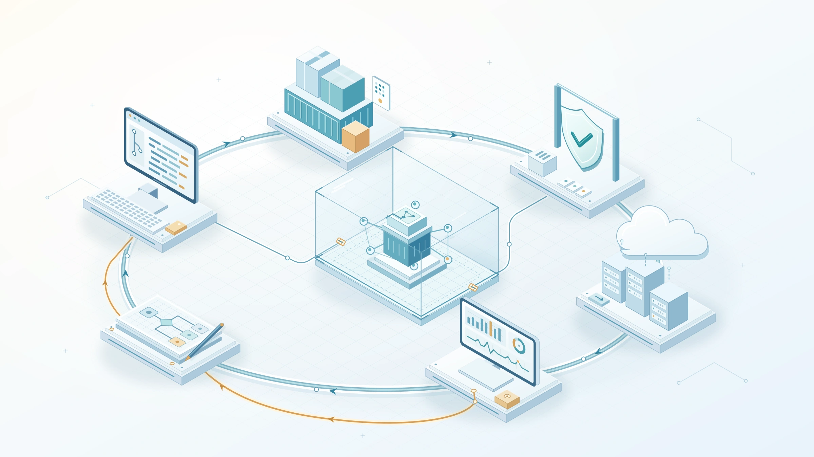

Un agente de IA actualiza una API, añade una dependencia y reconstruye su contenedor. El análisis de código pasa. La imagen no presenta vulnerabilidades que bloqueen la entrega. El despliegue termina correctamente.

Eso no demuestra que un cliente no pueda leer los registros de otro, que el ejecutor de compilación no haya expuesto una credencial o que nadie pueda persuadir al agente desplegado para que utilice indebidamente una herramienta autorizada.

**La brecha de seguridad no siempre es un escáner que falta. A menudo falta la conexión entre un riesgo, un control, la evidencia y alguien responsable de actuar.**

{/* truncate */}

*Documentación revisada el 8 de noviembre de 2026. Las funciones, licencias y plataformas compatibles cambian; consulta la documentación enlazada para tu entorno. Este es un modelo operativo recomendado, no una afirmación de que una combinación de herramientas elimina todas las vulnerabilidades.*

## Empieza por la cobertura, no por una lista de compras

Lo llames SecDevOps o DevSecOps, el objetivo es integrar la seguridad en el ciclo de vida del desarrollo de software, o SDLC. Adelantar un escáner resulta útil. Adelantar los requisitos de seguridad, el modelado de amenazas y la asignación de responsabilidades es más importante.

Los agentes de IA aumentan el volumen y la velocidad de los cambios. También incorporan entornos de ejecución, integraciones de herramientas e identidades de máquina que necesitan sus propios controles. La ingeniería de seguridad existente sigue siendo válida; debe cubrir esas nuevas vías.

Yo empezaría con cuatro preguntas para cada riesgo importante:

1. ¿Qué debemos prevenir, detectar o contener?
2. ¿Qué control aborda ese riesgo y dónde se ejecuta?
3. ¿Qué evidencia demuestra que el control se ejecutó sobre el cambio que se entregará?
4. ¿Quién corrige un hallazgo, aprueba una excepción o responde a un incidente?

Adelanta la seguridad cuando la retroalimentación pueda ser rápida y útil. Conserva la verificación y la supervisión en las etapas posteriores, donde se hacen visibles la configuración desplegada y el comportamiento real.

## Un mapa de cobertura del SDLC

Este es un punto de partida, no una lista universal de cumplimiento. Asigna equipos concretos a la columna de responsables y documenta cualquier área sin cubrir.

| Etapa y riesgo | Controles principales y herramientas adecuadas | Evidencia que conservar | Responsable |
|---|---|---|---|
| Diseño: límites de confianza inseguros y exposición de datos | Modelado de amenazas, requisitos de OWASP ASVS, revisión de privacidad | Flujos de datos, casos de abuso, requisitos de seguridad verificables | Equipo de producto con AppSec |
| Programación: lógica vulnerable y filtración de secretos | Análisis de código y secretos de GHAS, protección de inserciones, revisión | Análisis del commit, hallazgos revisados, registros de revocación de secretos | Equipo de desarrollo |
| Dependencias: paquetes vulnerables o no confiables | Revisión de dependencias, Dependabot, fuentes de paquetes aprobadas | Cambios de dependencias, archivos de bloqueo, origen de paquetes, decisiones de corrección | Equipo de desarrollo |
| Infraestructura y CI: privilegios excesivos o configuración insegura | Comprobaciones de IaC, revisión de flujos, aislamiento de ejecutores, privilegio mínimo | Resultados de políticas y cambios de identidad/red aprobados | Equipo de plataforma |
| Compilación: artefactos vulnerables o sustituidos | Docker Scout, SBOM, procedencia de compilación, entorno de compilación protegido | Digest de imagen, inventario de componentes, resultados del análisis, procedencia | Equipo de compilación/plataforma |
| Integración: autorización defectuosa y API expuestas | DAST autenticado, pruebas negativas de API, pruebas manuales de seguridad | Roles, rutas y límites entre clientes probados, con sus resultados | Equipo de desarrollo con AppSec |
| Comportamiento del agente: uso indebido de herramientas e inyección de instrucciones | Herramientas restringidas, autorización externa, evaluaciones adversariales | Pruebas de acciones denegadas y versiones de modelos/herramientas/políticas | Responsable del servicio de agentes |
| Entrega: artefacto no verificado o controles omitidos | Verificación de atestaciones, política de despliegue, entornos protegidos | Digest del artefacto aprobado, decisión del control, persona que aprueba | Equipo de entrega/plataforma |
| Operaciones: desviaciones, nuevas vulnerabilidades y abuso | Evaluación continua de vulnerabilidades, postura de seguridad en la nube, supervisión en ejecución | Inventario desplegado, alertas, registros de corrección y respuesta | SRE/operaciones de seguridad |
| Retirada: accesos huérfanos y datos conservados | Revocar identidades, eliminar integraciones, aplicar políticas de eliminación/retención | Lista de retirada y eliminación de accesos verificada | Responsables del servicio y de los datos |

Un escáner puede aportar evidencia para una fila. No asume la responsabilidad de esa fila.

## Qué cubren realmente GHAS, Docker Scout y OWASP

### GHAS: código, secretos y retroalimentación desde el repositorio

[GitHub Advanced Security](https://docs.github.com/en/get-started/learning-about-github/about-github-advanced-security) no es un único análisis. La división actual de productos distingue **GitHub Code Security**, que incluye análisis de código y revisión de dependencias, de **GitHub Secret Protection**, que incluye análisis de secretos y protección de inserciones.

Algunas capacidades son gratuitas para repositorios públicos. La disponibilidad para repositorios privados e internos depende de la función, el plan y la licencia. El gráfico de dependencias y las alertas de Dependabot están incluidos en todos los planes; no presentes toda la seguridad de dependencias como una función de pago de GHAS.

Utiliza CodeQL para las pruebas estáticas de seguridad de aplicaciones, SAST, sobre código compatible y comprueba que se hayan analizado los lenguajes, la configuración de compilación y las rutas previstas. GitHub también documenta AI Scan para ampliar la cobertura de lenguajes y frameworks. Evalúa esa cobertura en lugar de suponer que cualquiera de los motores comprende todos los comportamientos de la aplicación.

El análisis de secretos detecta tipos de secretos compatibles y patrones configurados. La protección de inserciones puede impedir filtraciones compatibles antes de que entren en el repositorio. Ninguna de las dos funciones es un sistema general de prevención de pérdida de datos para las instrucciones, archivos o tráfico de red de un agente. Si una credencial quedó expuesta, revócala o rótala; borrar la línea no resuelve la exposición.

Copilot Autofix y los agentes de programación pueden proponer correcciones. La propuesta sigue necesitando revisión y verificación independiente.

### Docker Scout: inspecciona el artefacto que realmente entregas

[Docker Scout](https://docs.docker.com/scout/) inventaría los componentes de una imagen en una lista de materiales de software, o SBOM, y correlaciona ese inventario con información de vulnerabilidades. Complementa las comprobaciones de dependencias del código fuente porque una imagen también contiene paquetes de la imagen base y del sistema operativo.

Scout ayuda a identificar capas afectadas y actualizaciones de imágenes base. Sus [comprobaciones de políticas](https://docs.docker.com/scout/policy/) también cubren criterios como imágenes base aprobadas, usuarios predeterminados distintos de root y presencia de atestaciones de la cadena de suministro.

Presta atención a los requisitos de evidencia. Algunas políticas de imágenes base necesitan información de procedencia y muestran **No data** cuando falta. Eso no equivale a cumplimiento. Del mismo modo, una imagen cuyo usuario predeterminado no sea root todavía puede desplegarse con una configuración de ejecución insegura.

El [análisis continuo de imágenes](https://docs.docker.com/scout/explore/analysis/) requiere habilitar los repositorios y las integraciones correspondientes. Un análisis puntual con la CLI no establece supervisión continua. Scout no es SAST de aplicaciones, una prueba de autorización, un sandbox para agentes ni detección de intrusiones en ejecución.

### OWASP: requisitos y orientación, no un único producto

"Ejecutamos OWASP" no describe una cobertura concreta. Selecciona el proyecto pertinente:

- [OWASP ASVS](https://asvs.owasp.org/) ofrece requisitos verificables de seguridad de aplicaciones. Convierte los requisitos aplicables en criterios de aceptación, incluidas pruebas negativas.
- [OWASP SAMM](https://owaspsamm.org/model/) ayuda a evaluar y mejorar las prácticas de seguridad de la organización en gobernanza, diseño, implementación, verificación y operaciones.
- [OWASP Top 10 for Agentic Applications 2026](https://genai.owasp.org/resource/owasp-top-10-for-agentic-applications-for-2026/) ayuda a estructurar el análisis de amenazas específicas de agentes. Utilízalo junto con la orientación de seguridad para aplicaciones y LLM, no en sustitución de ella.

Las listas Top 10 son puntos de partida para conocer riesgos, no planes de pruebas exhaustivos ni certificaciones. [NIST SSDF](https://csrc.nist.gov/Projects/ssdf) puede aportar un marco más amplio de desarrollo seguro cuando los equipos necesitan un vocabulario común de prácticas y evidencia.

## Añade herramientas solo para una brecha definida

Para un servicio en contenedores centrado en GitHub, empezaría con GHAS, Docker Scout, requisitos derivados de OWASP, comprobaciones de infraestructura como código, IaC, pruebas dinámicas autenticadas de seguridad de aplicaciones, DAST, verificación de artefactos y controles de ejecución apropiados para la plataforma de alojamiento.

Es un conjunto de capacidades, no la obligación de comprar un producto para cada casilla.

| Brecha o restricción | Opción que evaluar | Criterio de selección |
|---|---|---|
| Otra cobertura de SAST o modelo de alojamiento | [Semgrep](https://docs.semgrep.dev/) | Compara lenguajes, reglas, profundidad del análisis y capacidades comerciales frente a las comunitarias con tu código. |
| Comprobaciones portables de secretos y dependencias | [Gitleaks](https://github.com/gitleaks/gitleaks) y [OSV-Scanner](https://google.github.io/osv-scanner/) | Abordan problemas distintos. Un hook local de secretos se puede omitir; conserva un control del lado del servidor. Las comprobaciones de dependencias dependen del inventario y los ecosistemas compatibles. |
| Otro escáner de imágenes | [Trivy](https://github.com/aquasecurity/trivy) | Evalúa la cobertura de imágenes/paquetes y la actualidad de la base de datos. Habilita los analizadores necesarios explícitamente; no todos los modos incluyen comprobaciones de configuración. |
| Comprobaciones de políticas de infraestructura | [Checkov](https://www.checkov.io/) o una integración existente de Trivy | Verifica la compatibilidad con los formatos reales de tus plantillas y la configuración generada. Analizar el código fuente no demuestra que coincida con el estado desplegado en la nube. |
| Comportamiento de aplicaciones web/API en ejecución | [ZAP Automation Framework](https://www.zaproxy.org/docs/automate/automation-framework/) | Configura la autenticación, el descubrimiento de la aplicación y las definiciones de API. Añade pruebas explícitas de lógica de negocio y autorización. |
| Identidad de artefactos fuera de un flujo exclusivo de GitHub | [Verificación con Sigstore Cosign](https://docs.sigstore.dev/cosign/verifying/verify/) | Verifica la identidad y el emisor confiables, además del digest del artefacto. Una firma válida por sí sola no determina su seguridad. |
| Detección en ejecución | [Falco](https://falco.org/docs/) o protección de cargas de la plataforma de alojamiento | Ajusta las capacidades al entorno. Supervisar eventos de Linux/contenedores no cubre universalmente servicios administrados o sin servidor. |

Prueba las alternativas con aplicaciones representativas y casos conocidos. Compara los hallazgos accionables, falsos positivos, esfuerzo de integración, licencias, mantenimiento y dónde se procesan el código fuente o los metadatos. Por ejemplo, Gitleaks indica actualmente que sus próximas versiones se limitarán a parches de seguridad; considera ese modelo de mantenimiento al elegirlo. No envíes material sensible a un nuevo servicio de análisis sin autorización.

Dos escáneres con funciones superpuestas pueden justificarse si demuestran cobertura adicional. Tres escáneres porque cada uno tiene un panel diferente, no.

## Convierte el mapa en un flujo de CI/CD obligatorio

El pipeline debe conectar la evidencia con la autoridad para entregar. Mi [artículo anterior sobre CI/CD](/blog/cicd-pipelines-agentic-era) aborda la verificación; aquí la ampliación fundamental es verificar toda la cadena de entrega.

1. **Antes de implementar:** define los casos de abuso y los criterios de aceptación de seguridad. Para una tarea de un agente, especifica los repositorios, herramientas, datos y acciones permitidos. Identifica los cambios que necesitan revisión de seguridad.
2. **En la solicitud de incorporación de cambios:** ejecuta comprobaciones de código, secretos, dependencias y configuración con permisos mínimos. Mantén el código no confiable lejos de credenciales de producción y ejecutores privilegiados. Exige revisión independiente de cambios en flujos, políticas, identidades e infraestructura.
3. **En una compilación protegida:** compila el commit revisado en un entorno limpio y controlado. Produce el artefacto de entrega, su SBOM y la información de procedencia. Analiza ese artefacto exacto. Separa la ejecución de la compilación de la autoridad de despliegue.
4. **En un entorno de prueba aislado:** despliega el artefacto candidato con datos sintéticos. Ejecuta DAST autenticado, pruebas de autorización de API y las evaluaciones de agentes aplicables. Verifica que la autenticación haya funcionado y se hayan alcanzado los endpoints previstos; un rastreo vacío significa falta de evidencia. Los análisis activos requieren autorización y pueden alterar el estado de la aplicación; utiliza un entorno de pruebas desechable.
5. **Al promover la versión:** verifica la evidencia y aprueba el mismo digest inmutable del artefacto, en lugar de recompilar desde una etiqueta cambiante. Aplica la política de entrega mediante la plataforma de despliegue, no como una sugerencia en la PR.
6. **Después del despliegue:** registra el digest en ejecución, reevalúa nuevas vulnerabilidades, detecta desviaciones de configuración y abuso, e incorpora los hallazgos a requisitos y pruebas de regresión.

El propio pipeline forma parte de la superficie de ataque. Sigue la [orientación de uso seguro de GitHub Actions](https://docs.github.com/en/actions/reference/security/secure-use): evita ejecutar código de PR no confiables en contextos privilegiados de `pull_request_target` o `workflow_run`, y no supongas que los artefactos o cachés de trabajos no confiables son seguros.

Utiliza [archivos de bloqueo de dependencias de flujos](https://docs.github.com/en/actions/concepts/security/workflow-dependency-lockfiles) cuando estén disponibles para fijar las dependencias directas y transitivas de las acciones. No fijan las llamadas a flujos reutilizables; referencia estos mediante SHA completos de commits y gestiona las dependencias en el repositorio del flujo invocado. Cuando no haya archivos de bloqueo disponibles, fija las acciones a SHA completos revisados. Mantén esas dependencias revisadas al día en lugar de congelarlas indefinidamente.

Utiliza [federación OIDC](https://docs.github.com/en/actions/concepts/security/openid-connect) en lugar de credenciales de nube de larga duración cuando sea compatible. Restringe la confianza al repositorio, flujo/referencia o entorno protegido previsto mediante las condiciones admitidas por el proveedor, y concede a la identidad resultante únicamente los permisos necesarios. Las credenciales de corta duración con un rol demasiado amplio siguen teniendo privilegios excesivos.

Las [atestaciones de artefactos](https://docs.github.com/en/actions/concepts/security/artifact-attestations) vinculan un artefacto con el origen de su compilación. Verifica contra la política el emisor confiable, la identidad del firmante/flujo, la revisión del código y el digest del artefacto. Adjuntar una SBOM o una firma no demuestra por sí solo que el artefacto sea seguro.

## Define qué bloquea una entrega

El código de salida de un escáner y tu decisión de entrega no son automáticamente lo mismo. Configura la integración para aplicar la política y prueba que una comprobación fallida impida realmente la promoción.

Esta es una política de ejemplo que debes adaptar al riesgo de la aplicación:

| Condición | Decisión predeterminada |
|---|---|
| Una credencial recién expuesta | Detener la promoción; revocar o rotar la credencial e investigar la exposición. |
| Una prueba fallida de aislamiento entre clientes, autorización o acción prohibida de una herramienta | Detener la promoción; tratarla como un requisito incumplido, aunque no exista una CVE. |
| Un nuevo hallazgo crítico/alto que cumpla los criterios de riesgo documentados del equipo | Bloquear hasta corregirlo o aceptarlo explícitamente mediante el proceso de excepciones. |
| Un análisis obligatorio falla, está incompleto o desactualizado, o no aporta datos | Bloquear porque la evidencia requerida es desconocida, no limpia. |
| No se puede verificar la identidad del artefacto o su procedencia confiable | Rechazar el artefacto. |

Combina la gravedad con la exposición, la posibilidad de explotación, la sensibilidad de los datos y la evidencia de explotación. Desconocer si una ruta es alcanzable no significa que sea inalcanzable. "No hay una corrección disponible" no significa "aceptable"; puede ser necesario contener el riesgo o desactivar la función afectada.

No eximas silenciosamente al trabajo pendiente existente. Asigna plazos de corrección y escala las exposiciones urgentes aunque la vulnerabilidad no haya sido introducida por la PR actual.

Las excepciones necesitan un responsable de riesgo identificado, una razón, un alcance limitado, controles compensatorios, una fecha de caducidad y una tarea de corrección registrada. Los agentes no deberían aprobar sus propias excepciones ni modificar la política que evalúa su resultado. Restringe la autoridad para omitir controles y registra su uso.

Para cada entrega, conserva el commit de origen, el digest del artefacto, las versiones de analizadores y políticas, la actualidad de los datos de vulnerabilidades, los hallazgos, las decisiones y las aprobaciones. Define la vigencia de la evidencia por control: la procedencia inmutable de una compilación y una evaluación de vulnerabilidades envejecen de manera distinta. Recopila evidencia de trabajos confiables; un archivo JSON escrito por un agente que afirma "passed" no constituye verificación.

Normaliza los hallazgos en una cola de corrección con responsables. Conserva la evidencia específica de cada analizador y elimina duplicados según componente, versión afectada, vulnerabilidad o regla y contexto del artefacto. SARIF resulta útil para hallazgos de análisis de código; no es un formato universal para SBOM, atestaciones ni telemetría de ejecución.

## Aborda los dos tipos de riesgo agéntico

### Agentes que participan en el desarrollo

Un agente de programación puede encontrar instrucciones en archivos del repositorio, incidencias, dependencias y respuestas de herramientas. Trata esas entradas como datos no confiables, no como permiso para cambiar su tarea o autoridad.

Dale un entorno de ejecución delimitado, acceso de red reducido y credenciales limitadas a la tarea. No expongas secretos de producción. Mi [comparación de sandboxes](/blog/sandboxing-coding-agents-copilot-docker) explica por qué el aislamiento, la conectividad y la identidad son controles separados.

Verifica los nombres de paquetes añadidos por el agente, la identidad de su publicador/origen, las versiones y el comportamiento de instalación. Que un paquete exista no lo hace automáticamente confiable, y que una base de vulnerabilidades no registre problemas no demuestra que sea benigno.

Exige revisión del diff y evidencia independiente de CI. Aplica el mismo estándar de seguridad a cambios humanos y de agentes; añade controles según la autoridad y el comportamiento implicados, no según una suposición basada en el nombre del autor de un commit.

### Agentes que operan dentro de la aplicación

Un agente de aplicación puede recuperar documentos, conservar memoria, llamar a API o utilizar servidores del protocolo de contexto de modelos, MCP. Analizar el contenedor de la aplicación no demuestra que esas acciones estén autorizadas.

Aplica la autorización fuera del modelo, para cada acción de herramienta y recurso de destino. Conserva los límites del usuario y cliente solicitantes en lugar de dar a todas las solicitudes una identidad de servicio compartida y sin restricciones. Valida los argumentos de las herramientas en el servidor y exige aprobación explícita para las acciones de alto impacto.

Mantén un inventario de servidores MCP, herramientas, proveedores de modelos y fuentes de datos. Revisa cambios en sus capacidades, permisos y procedencia. Considera potencialmente hostiles el contenido recuperado y las respuestas de herramientas, incluido el contenido guardado en memoria para su uso posterior.

Prueba casos adversariales controlados: un documento recuperado que pide al agente exceder su alcance, una respuesta de herramienta que intenta redirigir la tarea, una solicitud no autorizada entre clientes y una acción fuera de la lista permitida. Comprueba que el control externo deniegue la acción, no solo que el modelo diga que se negó.

Limita las llamadas a herramientas, el tiempo de ejecución y el gasto. Registra los metadatos necesarios de las acciones sin conservar indiscriminadamente instrucciones, secretos o datos de clientes. Mantén un mecanismo de emergencia para desactivar o revocar accesos y ensáyalo. Repite las pruebas cuando cambien modelos, instrucciones, herramientas, fuentes de recuperación o políticas, aunque el código de la aplicación no cambie.

Estos controles reducen el riesgo. No convierten la inyección de instrucciones en un problema resuelto.

## Mide las conexiones y después amplía

Empieza con un servicio representativo. Establece requisitos, responsables y una línea base de cobertura. Añade los controles que falten, prueba las rutas de fallo y convierte el pipeline resultante en un patrón reutilizable revisado antes de extenderlo.

Mide si el sistema funciona, no cuántas alertas genera:

- **Cobertura:** proporción de repositorios, lenguajes, artefactos y servicios desplegados dentro del alcance con evidencia completa y actual. Cuenta explícitamente los objetivos no compatibles u omitidos.
- **Respuesta:** tiempo para corregir exposiciones importantes, antigüedad de las excepciones y decisiones de riesgo vencidas.
- **Defectos que llegaron a producción:** incidentes y defectos de seguridad descubiertos tras la entrega, y si se convierten en nuevas comprobaciones preventivas.
- **Aplicación de controles:** si realmente se deniegan la ausencia de evidencia, las acciones no autorizadas de agentes y los artefactos inválidos.

Cuando aparezca un hallazgo en ejecución, conéctalo con el artefacto desplegado, el servicio responsable, el cambio de código y el control ausente. Así, adelantar la seguridad se convierte en un ciclo de retroalimentación y no en un despliegue anual de escáneres.

GHAS ayuda a proteger los cambios del repositorio. Docker Scout añade visibilidad de los artefactos. OWASP ayuda a definir qué verificar y cómo madurar la práctica. Las pruebas complementarias, los controles de la cadena de suministro, los límites de identidad y las operaciones cubren riesgos que esas herramientas no resuelven.

El objetivo no es un panel verde en cada producto. Es una decisión de entrega que puedas explicar con evidencia, controles cuya aplicación puedas demostrar y personas que asuman el riesgo restante.
