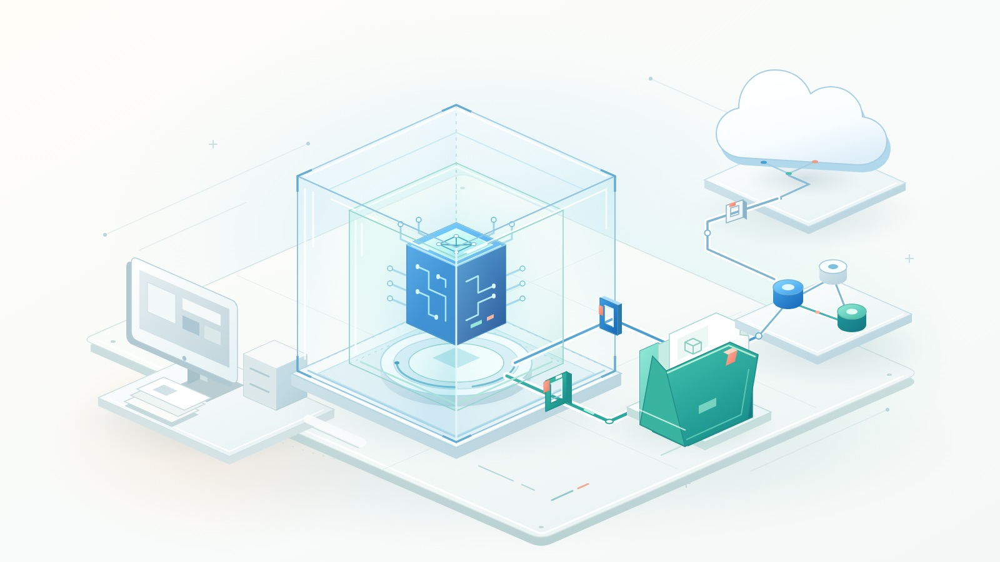

Corrigir um teste exige ler código, instalar dependências e executar comandos. Normalmente não exige chaves SSH, repositórios de outros clientes nem bancos de produção. Mesmo assim, um terminal com sua conta pode expor os três.

Não basta confiar na intenção do modelo. O ambiente deve limitar as consequências quando o modelo, uma dependência ou alguma instrução encontrada estiver errada.

**Isole a execução, não apenas a conversa.** GitHub Copilot e Docker oferecem sandboxes, mas seus limites são diferentes. Eles também podem funcionar juntos.

{/* truncate */}



*Documentação consultada em 5 de novembro de 2026. Comandos e plataformas mudam; confira a documentação para sua versão.*

## Por que o isolamento importa

Agentes conectam entradas não confiáveis a ferramentas poderosas. Repositórios, issues, páginas e respostas de ferramentas podem tentar redirecioná-los. Isso é injeção de prompt: conteúdo recebido como dado tenta se tornar autoridade. Dependências acrescentam outro risco: seus scripts executam código independentemente das intenções do modelo.

Um erro comum pode ter consequências semelhantes. O agente pode apagar o diretório errado, alterar configurações compartilhadas ou enviar informações de depuração a um destino inadequado.

Confirmações ajudam, mas aprovar comandos não constitui contenção. A permissão pergunta: "O agente pode executar esta ferramenta?". O sandbox limita seu alcance depois da aprovação. Instruções do repositório descrevem comportamentos esperados; não são controles de acesso do sistema operacional.

Separe três perguntas:

- **Execução:** Quais processos e arquivos o agente pode acessar ou modificar?
- **Conectividade:** Quais destinos e serviços ele consegue alcançar?
- **Autoridade:** Quais ações suas credenciais autorizam nesses serviços?

Isolamento forte não corrige tokens com privilégios excessivos. Permitir destinos não os torna confiáveis. Isolar o processo não torna local um modelo na nuvem: prompts, contexto de código e resultados permitidos ainda podem sair da máquina.

## GitHub Copilot: restrições locais ou sessão na nuvem?

"Sandbox do Copilot" descreve duas abordagens. Escolha explicitamente: suas interfaces não oferecem necessariamente o mesmo isolamento.

### Isolamento local: mantenha as ferramentas e limite seu alcance

O [isolamento local do Copilot](https://docs.github.com/en/copilot/concepts/security-governance-and-network-settings/about-cloud-and-local-sandboxes) usa Microsoft eXecution Container, ou MXC, para aplicar restrições do sistema operacional. Ele **não** coloca toda a sessão dentro de uma VM separada ou de um contêiner convencional.

A implementação usa Seatbelt no macOS, bubblewrap no Linux e recursos de isolamento do Windows 11 compatível. Linux precisa de componentes adicionais de rede; Windows depende das atualizações instaladas. Confira os requisitos: uma CLI funcionando não garante um sandbox funcionando.

O isolamento local vem desativado, salvo quando configurações gerenciadas o exigem. Dentro de uma sessão interativa do Copilot CLI, comece com:

```text
/sandbox enable
/sandbox status
/sandbox policy
```

A preferência persiste entre sessões. As configurações do aplicativo Copilot são separadas das configurações da CLI. Inspecione a política efetiva, não apenas a opção salva.

A [política do sistema de arquivos](https://docs.github.com/en/copilot/concepts/security-governance-and-network-settings/understanding-local-sandboxing) concede permissões automáticas ao diretório de trabalho, metadados do Git, ferramentas e determinados caches. Um subdiretório ainda pode conceder leitura do repositório inteiro. Algumas configurações contêm credenciais de registros; certos caches graváveis são compartilhados com comandos externos. Confira as permissões antes de presumir "apenas esta pasta".

Outro limite importante: o sistema operacional restringe comandos e subprocessos de busca, mas ferramentas integradas de leitura e edição verificam a política por software dentro da CLI não isolada. Servidores MCP e de linguagem locais são isolados por padrão; os MCP remotos ficam fora desse limite.

Confira também as [configurações de rede e credenciais](https://docs.github.com/en/copilot/how-tos/cloud-and-local-sandboxes/configuring-local-sandbox-settings). Fluxos compatíveis usam valores substitutos enquanto um proxy insere credenciais para destinos aprovados. Isso não protege automaticamente outros segredos em arquivos ou variáveis de ambiente.

No macOS e Linux, restrições impedem conexões diretas que contornem o proxy. No Windows, regras de hosts dependem de os programas respeitarem o proxy e de recursos compatíveis do sistema. Não são garantias equivalentes de saída.

Para uso obrigatório, administradores devem exigir isolamento, impedir exceções e bloquear a execução quando estiver indisponível. Em máquinas incompatíveis, uma preferência pessoal pode ser desativada para a sessão atual da CLI, com um aviso. Leia-o antes de delegar.

**Escolha para:** desenvolvimento local habitual quando conservar as ferramentas da máquina é útil e o limite documentado atende aos requisitos de risco.

### Sandboxes na nuvem: tire a sessão do seu notebook

Um [sandbox do Copilot na nuvem](https://docs.github.com/en/copilot/concepts/security-governance-and-network-settings/about-cloud-sandboxes) executa a sessão completa em Linux isolado, hospedado pelo GitHub. Clona os repositórios necessários; não trabalha no diretório local.

No Copilot CLI, inicie uma sessão interativa na nuvem com:

```bash
copilot --cloud
```

Isso ajuda no trabalho paralelo, em tarefas longas e em sessões retomadas de outro cliente. Configurações locais não são transferidas. Há cobrança por uso; sessões paradas mantêm snapshots para retomada. Parar não significa apagar.

Diferencie também a execução **Cloud** da execução **Actions**. O GitHub documenta sessões baseadas em Actions para personalizar runners, preparar o ambiente ou usar Windows. Um runner auto-hospedado herda os riscos do ambiente fornecido; "remoto" não constitui, sozinho, um limite de segurança.

Esses sandboxes usam as configurações de firewall do agente na nuvem do Copilot. Porém, as [limitações documentadas do firewall](https://docs.github.com/en/copilot/how-tos/copilot-on-github/customize-copilot/customize-the-firewall) incluem cobertura limitada aos processos Bash iniciados pelo agente, sem cobrir diretamente servidores MCP ou etapas configuradas de preparação. O GitHub também alerta para a possibilidade de contornar o firewall. Use-o como uma camada, não como prova de que vazamentos sejam impossíveis.

**Escolha para:** trabalho delegado em repositórios que não deva consumir recursos nem acessar arquivos locais, quando a política organizacional permitir execução na nuvem.

## Docker Sandboxes: uma microVM ao redor do agente

[Docker Sandboxes](https://docs.docker.com/ai/sandboxes/architecture/) oferece outro limite local: uma microVM com kernel e Docker Engine próprios. O agente pode instalar pacotes e executar contêineres sem receber acesso ao daemon Docker da máquina.

Isso não equivale a um `docker run` convencional. Contêineres Linux comuns compartilham o kernel do sistema que os hospeda. Montar o socket Docker do host dentro de um contêiner também concede controle poderoso sobre o daemon e pode enfraquecer o isolamento pretendido. Docker Sandboxes fornece um daemon separado.

A [instalação atual](https://docs.docker.com/ai/sandboxes/install/) usa a CLI independente `sbx`, sem exigir Docker Desktop nem Docker Engine no host. Suporta macOS com Apple silicon, Windows 11 com o hipervisor necessário e Ubuntu compatível com KVM. Exige virtualização por hardware, aninhada quando o host é uma VM.

O Docker fornece uma [integração com Copilot](https://docs.docker.com/ai/sandboxes/agents/copilot/), além de outros agentes. Não é uma escolha entre a inteligência do Copilot e a do Docker. Copilot é o agente; Docker fornece o ambiente de execução.

### O espaço de trabalho continua sendo uma abertura deliberada

Os [modos do espaço de trabalho](https://docs.docker.com/ai/sandboxes/usage/) têm consequências diferentes:

- **Montagem direta:** `sbx run` compartilha o diretório atual com leitura e escrita por padrão. Alterações afetam imediatamente os arquivos do host, inclusive arquivos ocultos e hooks do Git.
- **Modo clone:** o repositório do host é montado somente para leitura, e o agente trabalha em um clone privado na VM. Somente leitura impede alterações, não a divulgação de segredos no diretório original.
- **Sem montagem:** crie o sandbox sem informar um caminho de trabalho e depois clone ou copie apenas o necessário.

Instale `sbx`, entre no Docker e configure a autenticação documentada do Copilot com uma credencial adequada. Depois:

```bash
sbx create --clone --name agent-lab --skills=off copilot .
sbx policy ls
sbx run --name agent-lab
```

Execute no checkout principal, limpo e sem segredos, não em um worktree vinculado. Pare após inspecionar as regras e restrinja-as antes de iniciar o agente. `--skills=off` evita compartilhar o armazenamento de habilidades do host com esse sandbox.

O modelo de ambiente do Copilot fornecido pelo Docker atualmente inicia o agente com `--yolo`. Isso torna o limite externo especialmente importante: não presuma que as confirmações normais por ferramenta continuam ativas. O exemplo é um fluxo inicial, não uma política completa de segurança.

### Credenciais e integrações também cruzam limites

Com [credenciais gerenciadas pelo proxy](https://docs.docker.com/ai/sandboxes/configuration/credentials/), o agente vê um valor substituto, e o proxy do host insere o valor real nas solicitações correspondentes. Segredos colocados diretamente em arquivos ou variáveis de ambiente comuns não recebem essa proteção. Um token oculto ainda pode autorizar uma ação poderosa; limite suas permissões.

O [modelo de segurança](https://docs.docker.com/ai/sandboxes/security/) documenta uma rede que bloqueia por padrão, com destinos permitidos preconfigurados. Revise as regras: curingas amplos podem incluir mais serviços do que a API pretendida. Servidores MCP locais por stdio registrados no gateway do Docker executam no **host**, fora da microVM. Trate-os como integrações confiáveis com permissões próprias.

O estado persiste até a remoção do sandbox. Parar o agente não descarta pacotes instalados ou alterações. Exporte o trabalho revisado antes de remover um sandbox em modo clone.

O Docker também oferece [sandboxes na nuvem](https://docs.docker.com/ai/sandboxes/cloud/local-vs-cloud/), mas montagens, credenciais, políticas e ciclo de vida locais não se transferem sem mudanças. Avalie essa configuração separadamente.

## Qual abordagem eu escolheria?

| Situação | Escolha inicial | Principal compromisso |
|-----------|-----------------|---------------|
| Repositório conhecido e ferramentas locais existentes | Isolamento local do Copilot | Pouca mudança no trabalho; controles dependentes do host e permissões automáticas |
| Trabalho delegado sem acesso nem processamento do notebook | Sandbox do Copilot na nuvem | Execução remota gerenciada; políticas, tratamento de dados e custos separados |
| Agente precisa de builds Docker e contêineres de teste | Docker Sandbox local, possivelmente com Copilot | Kernel e daemon separados; requisitos e consumo de virtualização |
| Código ou scripts de instalação desconhecidos | MicroVM ou VM dedicada descartável, com dados compartilhados mínimos | Separação maior; ainda exige restringir rede e credenciais |
| Alterações em produção ou dados sensíveis de clientes | Fluxo aprovado separado | Nenhuma opção justifica autoridade irrestrita sobre produção |

Não é um ranking. Uma microVM com credenciais amplas e o diretório pessoal gravável pode expor mais autoridade do que um ambiente leve cuidadosamente restrito.

## Dois casos práticos

### 1. Atualizar uma dependência de um serviço conhecido

Suponha que o agente deva atualizar uma biblioteca de logs, adaptar algumas chamadas e executar testes unitários. O repositório e o processo de build são conhecidos, mas a nova dependência merece revisão.

Eu começaria com isolamento local do Copilot, inspecionaria a política efetiva, excluiria segredos e permitiria apenas as fontes de pacotes necessárias. Não daria credenciais de implantação. Um checkout descartável separa o trabalho alheio à tarefa, embora não seja, sozinho, um sandbox de segurança.

O resultado deve incluir um diff focado, alterações de dependências e evidências dos testes. Revise lockfiles e scripts de instalação, não apenas o código da aplicação. Se a atualização envolver scripts desconhecidos ou privilégios mais amplos, mova a execução para uma VM descartável em vez de aprovar exceções locais cada vez maiores.

### 2. Reproduzir um erro em um projeto com contêineres

Agora imagine um serviço desconhecido com uma stack Compose, um banco de dados e scripts de migração. O agente precisa construir imagens e reiniciar repetidamente os dados de teste.

Docker Sandboxes faz sentido porque fornece um Docker Engine privado sem o socket do host. Use um clone sem informações sensíveis ou um espaço sem montagem, registros sintéticos e nenhuma conexão de produção. Restrinja destinos aos registros e serviços necessários.

O agente pode recriar sua stack de testes sem autoridade sobre os demais contêineres do desenvolvedor. Antes de incorporar o resultado, inspecione scripts, Dockerfiles, configuração do Compose e dependências. Com montagem direta, confira também `.git/hooks` separadamente: hooks não aparecem em um `git diff` comum.

Se o notebook e sua rede não devem participar, use um ambiente aprovado na nuvem com controles equivalentes. É uma decisão de localização, não uma razão para abandonar os controles.

## Alternativas que merecem consideração

**Dev containers e GitHub Codespaces:** dev containers tornam as ferramentas reproduzíveis, mas não são automaticamente ambientes protegidos para agentes não confiáveis. Revise montagens, privilégios, segredos e acesso ao socket Docker. [Codespaces](https://docs.github.com/en/codespaces/reference/security-in-github-codespaces) acrescenta uma VM e uma rede dedicadas por codespace, mas permite tráfego de saída para a internet, e segredos injetados ficam disponíveis aos processos. É útil como ambiente remoto completo, com política de segurança deliberada.

**Sessões dinâmicas do Azure Container Apps:** [sessões dinâmicas](https://learn.microsoft.com/en-us/azure/container-apps/sessions) fornecem execução isolada por Hyper-V para código não confiável. Avalie-as ao construir uma aplicação que executa código gerado por agentes, em vez de escolher uma CLI interativa. Você continua responsável por autorização, localização dos dados, configuração da rede e ciclo de vida.

Uma VM dedicada descartável também é válida quando as plataformas ou os controles de um produto não atendem aos requisitos. Nesse caso, você mantém as imagens, a proteção e a limpeza.

## Verifique o limite antes de ampliar a autonomia

Use uma lista curta de aceitação, não um nome de produto tranquilizador:

1. **Mapeie a exposição.** Identifique arquivos legíveis, montagens graváveis, caches compartilhados, credenciais, ferramentas MCP e serviços acessíveis. Mantenha segredos de produção fora.
2. **Teste sem riscos.** Use arquivos inofensivos dentro e fora do espaço permitido e um destino de teste aprovado fora da lista permitida. Verifique que operações autorizadas funcionem e operações negadas falhem. Nunca teste com segredos reais.
3. **Confira cada mecanismo.** Inspecione status, regras efetivas, limitações de plataforma e exceções ao isolamento. Um teste de shell não demonstra controles idênticos em ferramentas integradas ou serviços MCP remotos.
4. **Limite a execução.** Configure limites adequados de CPU, memória, tempo e gastos quando disponíveis. Preserve logs úteis sem coletar conteúdo sensível.
5. **Revise e encerre.** Confira o diff e as configurações ocultas relevantes, execute verificações independentes, exporte apenas os artefatos necessários e remova ambientes descartáveis e credenciais temporárias.

O isolamento reduz o alcance dos danos. Não impede toda injeção de prompt, não garante código correto nem desfaz ações autorizadas contra serviços externos.

Escolha o limite pelo que a tarefa precisa alcançar, não pelo quanto você confia no agente. Dê espaço para ele trabalhar e mantenha a autoridade para alterar esse limite fora do controle do agente.
